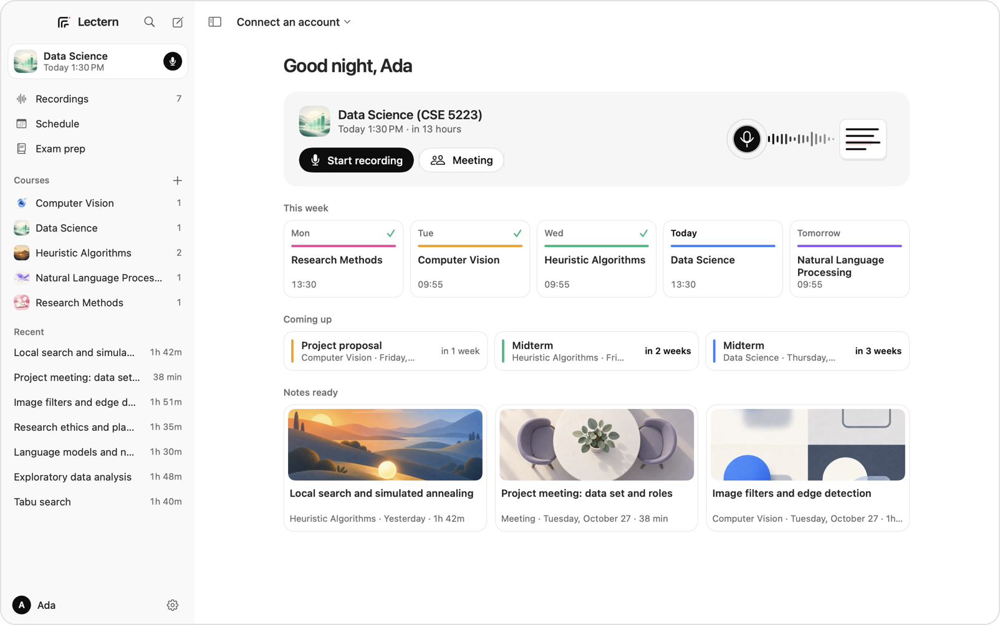
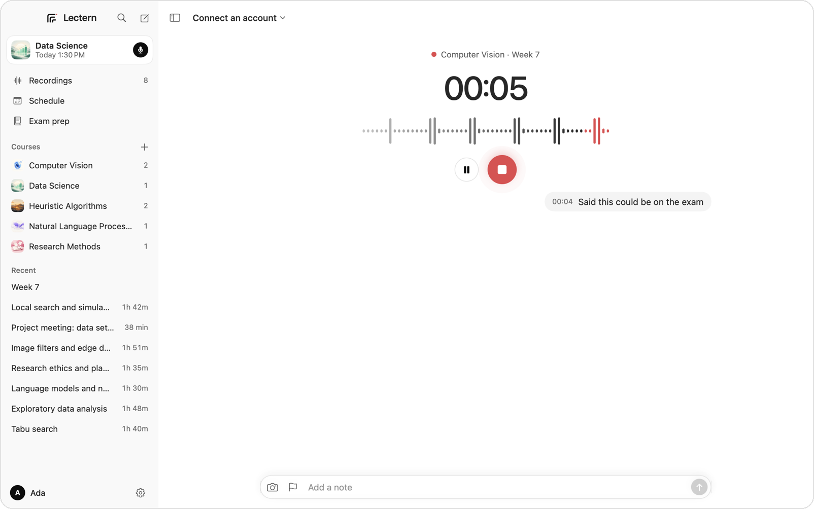
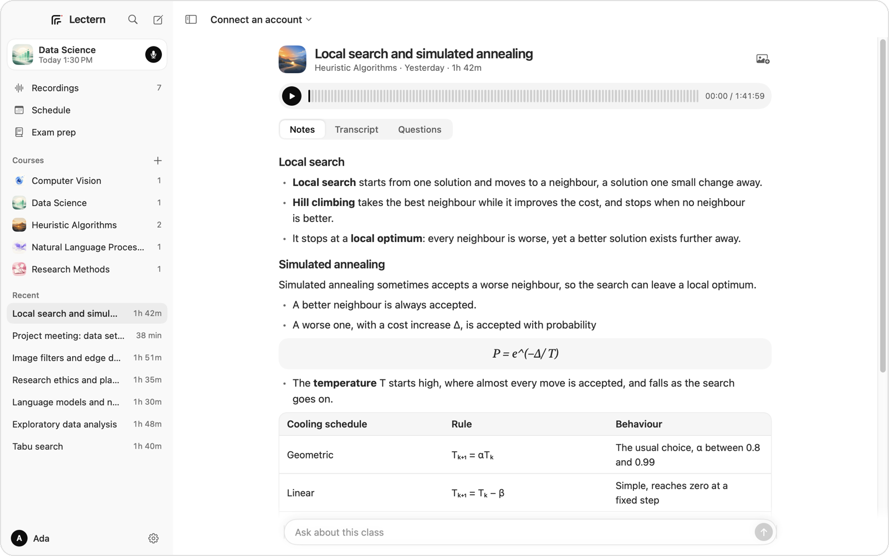
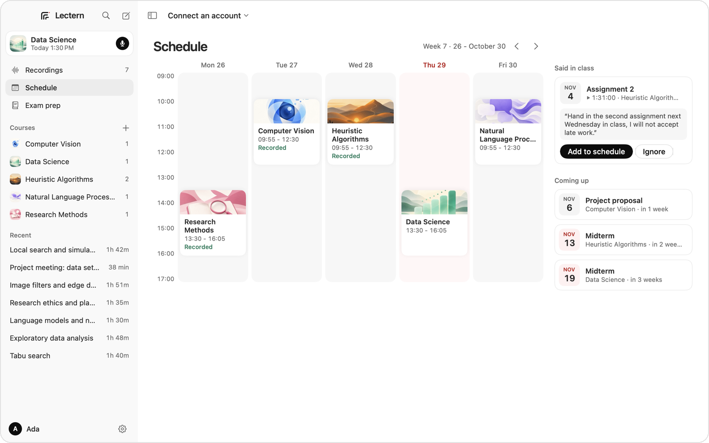
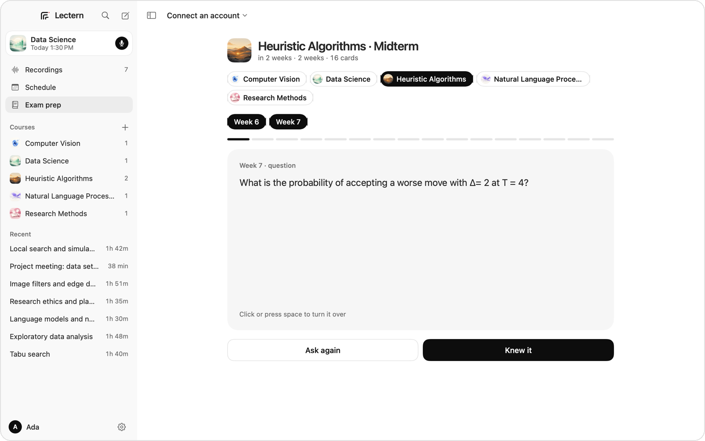

<p align="center">
  
</p>

<h1 align="center">Lectern</h1>

<p align="center">Record your lectures on a Mac. Get the notes, practice questions and every date your lecturer mentioned.</p>

<p align="center">
  <a href="LICENSE"></a>
  
  
  
</p>

<p align="center">
  
</p>

<table>
  <tr>
    <td width="50%" valign="top">
      
      <p><b>Record</b><br>Keeps recording if the app quits. Type a note or add a board photo as you go.</p>
    </td>
    <td width="50%" valign="top">
      
      <p><b>Read the notes</b><br>Transcript, notes and questions, with formulas, tables and your photos in place.</p>
    </td>
  </tr>
  <tr>
    <td width="50%" valign="top">
      
      <p><b>Catch every date</b><br>Exams and deadlines said in class, in the lecturer's own words.</p>
    </td>
    <td width="50%" valign="top">
      
      <p><b>Study for the exam</b><br>Each lecture's questions become cards. The ones you missed come back first.</p>
    </td>
  </tr>
</table>

## Your account, your files

| | Works with |
|---|---|
| Transcription | Gemini (a Google AI Studio key) |
| Notes, questions, answers | Sign in with ChatGPT, a Claude, OpenAI or Gemini key, or a local OpenAI-style server |

No Lectern server and no sign-up. Keys stay in the macOS Keychain, lectures stay in `~/Documents/Lectern` as plain files.

## Install

```sh
brew install katex35/tap/lectern
lectern
```

Homebrew builds it on your Mac in a couple of minutes, so macOS opens it without asking. It needs macOS 14 or later and the Xcode Command Line Tools.

<details>
<summary>More</summary>

<br>

**Building from source** needs macOS 14 or later and Swift 5.10 or later (Xcode 16):

```sh
swift build && swift test
scripts/bundle.sh && open build/Lectern.app
```

The microphone permission and notifications need the app bundle; `swift run Lectern` works for everything else.

**Files**

```
Courses/<course>/course.json          name, language, weekly times, exams
Courses/<course>/<date> Week <n>/     recordings, transcript.txt, notes.md, questions.md,
                                      dates.json, chat.json, board/ photos, cover.jpg
Meetings/<date> <time>/               the same for a meeting
```

When Lectern writes a file again, the old one goes to `.lectern/previous` in the lecture's folder.

**Covers** are drawn from each course's and lecture's topic with an OpenAI or Gemini key. The picture idea is checked first, and the image model is told to leave out people, text and symbols.

**For development**

| Variable | Effect |
|---|---|
| `LECTERN_LIBRARY=<folder>` | Use another library folder |
| `LECTERN_SIMULATE=<seconds>` | Record a generated tone instead of the microphone |
| `LECTERN_FAKE_AI=1` | Run transcription, notes, chat and covers on stand-ins, without any account |
| `LECTERN_SNAPSHOT=<folder>` | Save each main screen as a PNG and quit |
| `LECTERN_USER_NAME=<name>` | Greet another name in screenshots |
| `LECTERN_IMPORT=<folder>` | Import lectures from the ders-kayit tool into an empty library |

The screenshots above come from a made-up demo library.

</details>

## Türkçe

Lectern dersini Mac'te kaydeder; kaydı yazıya döker, notu ve çalışma sorularını senin bağladığın hesapla yazar, derste söylenen sınav ve teslim tarihlerini yakalar. Her şey kendi diskinde, düz dosyalar halinde durur.

## License

MIT, see [LICENSE](LICENSE).
